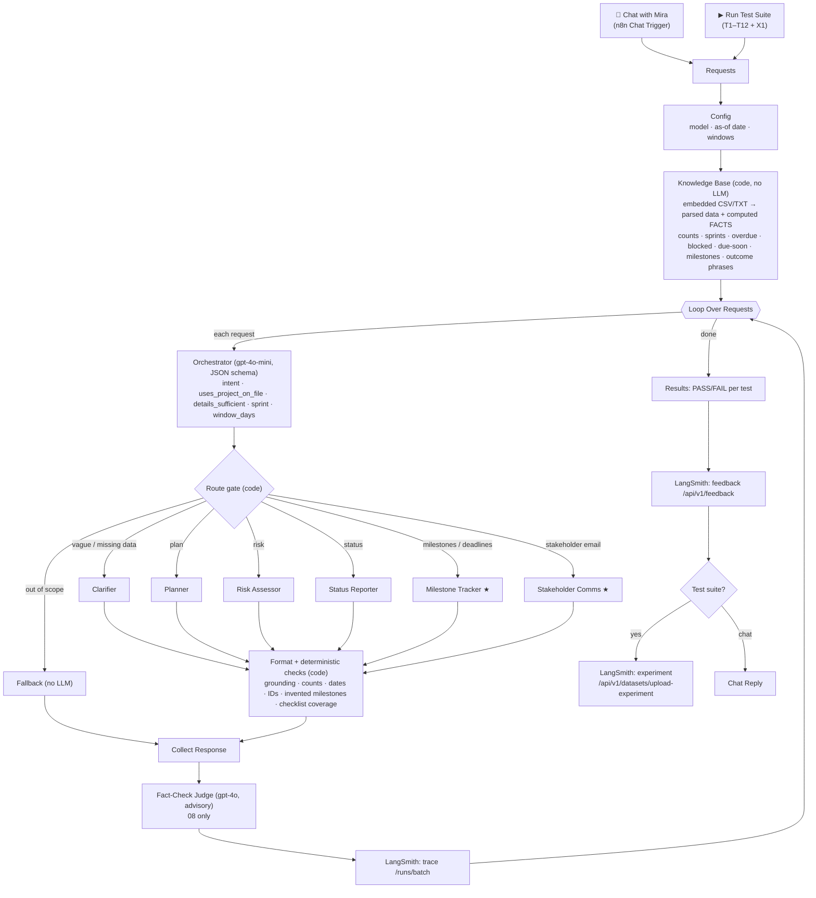
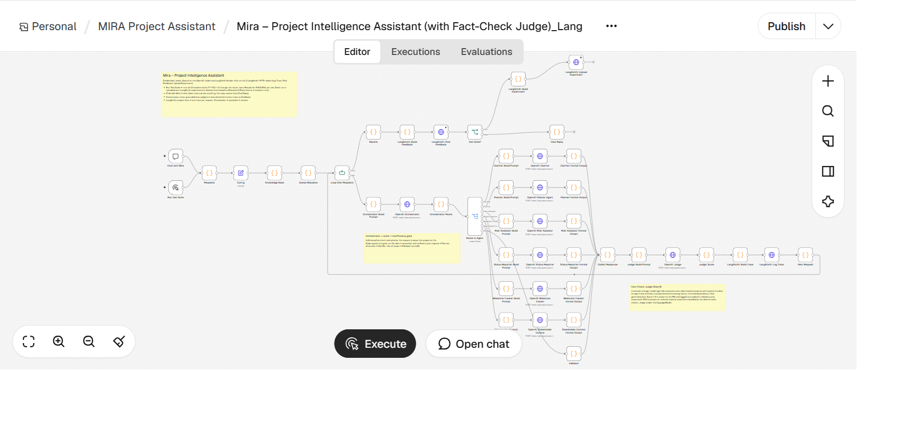
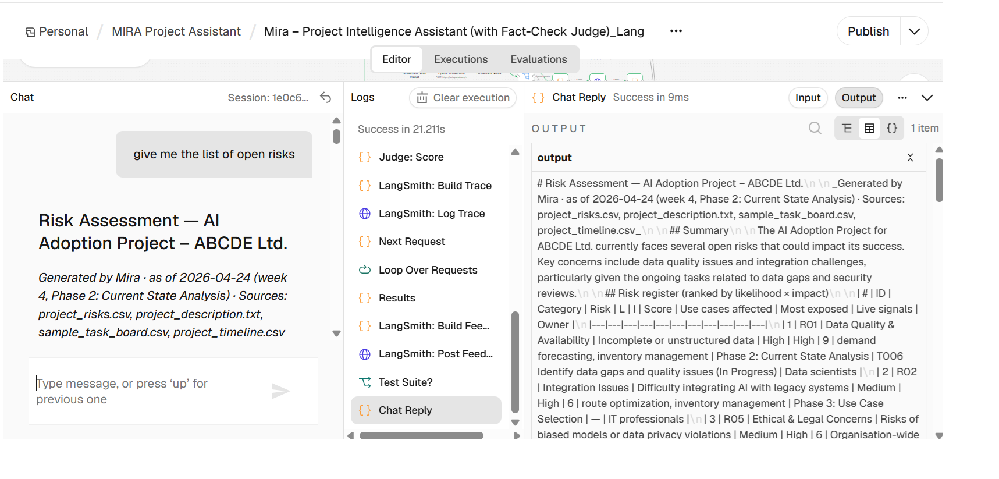
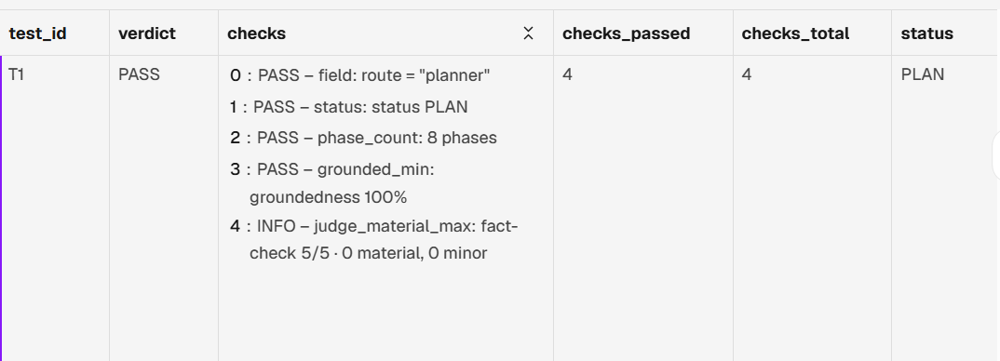
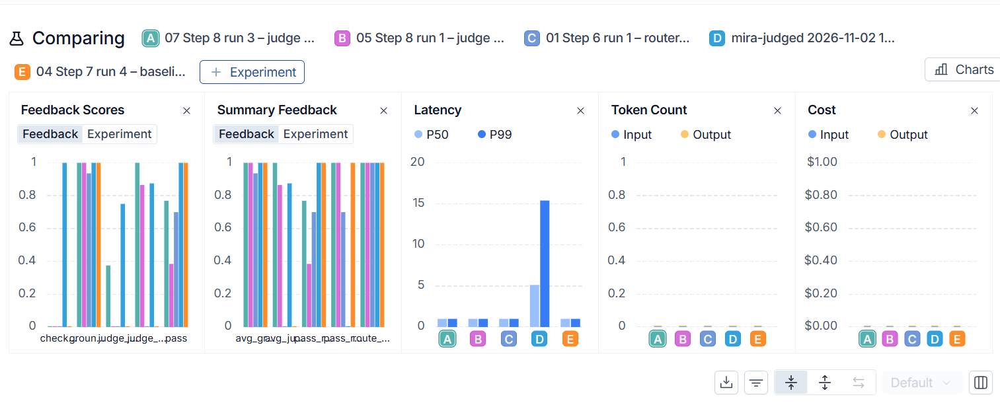
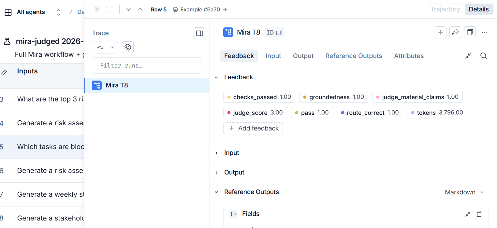
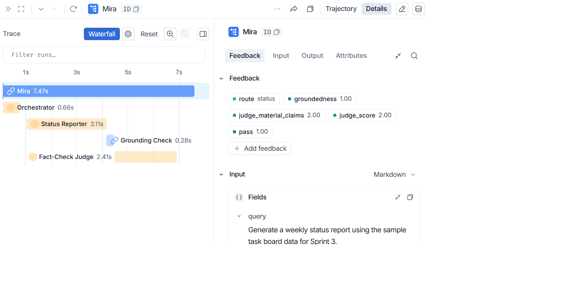
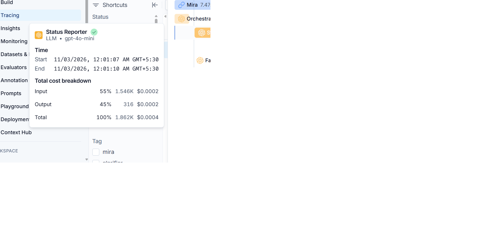

# Mira — AI-Powered Project Intelligence Assistant

Mira is a multi-agent assistant for PMs/TPMs at Nexora. It turns raw project data (description, timeline, risk register, task board) into structured, ready-to-use outputs: **project plans, risk assessments, weekly status reports, milestone alerts and stakeholder update emails**. It is built as an **n8n** workflow using **OpenAI gpt-4o-mini**, with full tracing and evaluation in **LangSmith**.

> Capstone: *Applied Agentic AI for PMs/TPMs*. The project is ABCDE Ltd. AI Adoption (logistics, 24 weeks, 8 phases).

| | |
|---|---|
| **Baseline result** | **13/13 PASS** (T1–T12 plus an out-of-scope test X1), 100% groundedness, 100% routing accuracy |
| **Cost** | ≈ **$0.0007 per request** with gpt-4o-mini; ≈ $0.009 for the full 13-test suite (+ ≈ $0.07 with the optional gpt-4o fact-check judge) |
| **Latency** | Median **4.4 s** per request; 12–15 s for full plans and risk assessments |
| **Observability** | One LangSmith trace per request (Orchestrator → specialist → checks), scores attached as trace feedback, and every suite run uploaded as a LangSmith **experiment** |

**Assignment documents:**
- [Q1 Ideation](docs/Q1_ideation.md)
- [Q2 Build writeup](docs/Q2_writeup.md)
- [Q3 Program charter](docs/Q3_program_charter.md)
- [Q4 Reflection](docs/Q4_reflection.md)

---

## 1. Architecture

**Orchestration pattern: Router / Dispatcher with a deterministic data layer.**



★ = extended capability. Each specialist is a 3-node unit: **Build Prompt** (code) → **OpenAI** (HTTP, strict JSON schema) → **Format Output** (code).

**The workflow in n8n** (`08_mira_judged.json`):



**Mira in action** (n8n chat): "give me the list of open risks" is routed to the Risk Assessor.



### Why this design

| Decision | Rationale |
|---|---|
| **Router, not a sequential pipeline** | PM requests vary (plan vs risk vs status vs email). A router runs only the specialist that is needed: one LLM call instead of five, which is cheaper and faster, and each agent can be tested on its own. |
| **Code computes, the LLM writes** | Counts, sprint filters, overdue/blocked/due-soon flags, date windows, milestone↔task links and risk ranking (likelihood × impact) are computed in code and passed to the agent as FACTS. Tables in the output are rendered by code. The model writes only the narrative, so T5, T8, T10, T11 and T12 are correct by construction. |
| **Structured output with enums** | Every agent returns OpenAI strict `json_schema`. Wherever possible the schema *restricts what the model can say*: task IDs limited to the in-scope tasks, risk IDs keyed one-per-register-risk, evidence quotes chosen from 20 verbatim phrases of the project description, phases and use cases from fixed lists. Hallucination becomes a schema violation rather than a prompt-compliance problem. |
| **Insufficiency gate in code** | The Orchestrator LLM classifies the request; a code gate decides the route. Data on file → specialist. A plan request with enough detail → Planner. Anything else → **Clarifier**, which asks for the missing items from a per-intent checklist and never invents a plan (T2, T4, T6, T9). |
| **Deterministic checks on every answer** | Each Format node verifies the narrative against the data: quotes exist in the source, every cited ID/number/date (in any format) is real, no invented milestones, no out-of-scope tasks, actionable next steps, checklist coverage. The result is shown to the PM ("Grounding check: 8/8 ✅") and logged to LangSmith. |
| **LLM judge = advisory only** | A gpt-4o Fact-Check Judge reviews claims the code cannot check. Measured material precision was ≈ 33–67% and inconsistent between identical claims (see §4), so its score is shown and logged but **never decides pass/fail**. |
| **No agent tools / no RAG** | The whole knowledge base (≈ 25 tasks, 10 risks, 8 phases) fits in context, and code already selects the relevant slice per request. Tool calls would add nondeterminism without adding information. |
| **Data embedded in the workflow** | n8n Cloud has no local file access. Embedding the files makes the JSON self-contained and reproducible for anyone who imports it. |
| **HTTP Request nodes for OpenAI and LangSmith** | They expose token usage and `openai-processing-ms` latency for tracing. n8n Cloud cannot use LangSmith environment variables, so LangSmith is called via its REST API. |
| **Configurable as-of date (2026-04-24)** | All project dates are in Apr–Aug 2026. A fixed "today" makes overdue/upcoming logic meaningful and the tests repeatable. |

### Agents

| Agent | Input it sees | Output | Key guardrails |
|---|---|---|---|
| **Orchestrator** | Request only | intent, on-file flag, sufficiency, sprint, window | JSON schema; routing decided by code |
| **Clarifier** | Request + intent checklist | What's known, what's missing, questions | Must cover every checklist item; no project facts |
| **Planner** | Description + timeline | Plan: objectives, scope, 8 phases, milestones, metrics, governance | Every item carries a verbatim source quote (checked) |
| **Risk Assessor** | Register R01–R10 + description + live task signals | Likelihood, impact, rationale, evidence, affected use cases, owner, next step per risk | Keyed schema forces all 10 risks; blocked/overdue task ⇒ likelihood ≥ Medium; next step must be an action |
| **Status Reporter** | Scoped task board FACTS + linked milestones | Headline, summary, highlights, concerns, focus, decisions | Counts and RAG from code; only listed milestones; Done ≠ overdue |
| **Milestone Tracker ★** | Timeline + task board, window from request | Milestones in window with linked tasks, at-risk tasks, actions, escalations | Risk rules (Blocked/Overdue/At risk/Due soon) in code |
| **Stakeholder Comms ★** | Sprint-scoped tasks + related milestones | Professional email | Task-ID enum = in-scope tasks only; exact task names printed by code; no "on schedule" claims |
| **Fallback** | — | Out-of-scope reply with capability list | No LLM |
| **Fact-Check Judge** (08) | Exactly the data + narrative of the specialist | Unsupported claims with severity; score 1–5 computed in code | Advisory only |

---

## 2. Repository layout

```
workflows/            Importable n8n workflows (built by build_workflows.py)
  01_smoke_test_langsmith.json   Step 1 – OpenAI → LangSmith connectivity
  02_knowledge_base.json         Step 2 – knowledge base + computed facts (self-check)
  03–05_*.json                   Steps 3–5 – Planner / Risk Assessor / Status Reporter, each with its tests
  06_mira_orchestrator.json      Step 6 – first router version (superseded by 07)
  07_mira_complete.json          ★ Full Mira: chat + test suite, 6 agents + fallback, LangSmith trace/feedback/experiment
  08_mira_judged.json            ★ 07 + gpt-4o Fact-Check Judge (advisory)
  09_langsmith_history.json      One-off: uploads the recorded runs as LangSmith experiments
src/                  JavaScript for every Code node (prompts, formatters, checks, LangSmith payloads)
Resources/            Source project data (description, timeline, risks, task board, test inputs)
results/              Results JSON of the final runs + history/ (8 earlier suite runs)
Screenshots/          n8n and LangSmith screenshots
build_workflows.py    Generates workflows/*.json from src/ + Resources/
PLAN.md               Research, design and the full run-by-run build log (failure → fix → retest)
```

## 3. Setup (n8n Cloud)

1. **Credentials** in n8n:
   - *OpenAI* (API key).
   - *LangSmith* as **Header Auth**: name `x-api-key`, value = your LangSmith API key.
2. **Import** `workflows/07_mira_complete.json` (or `08_mira_judged.json` for the judge version).
3. Select the **OpenAI** credential on the `OpenAI:` nodes, and the **LangSmith** credential on the 3 `LangSmith:` HTTP nodes (Log Trace, Post Feedback, Upload Experiment).
4. **Run Test Suite**, then open **Results**: PASS/FAIL per test with check details and the rendered response.
5. **Chat with Mira**: click *Open chat* and ask, e.g. "What are the top 3 risks?" or "Draft a stakeholder update for Sprint 2".
6. LangSmith:
   - project **mira** → one trace per request;
   - **Datasets & Experiments → mira-baseline** → experiments; select several → **Compare**.

Settings live in the **Config** node: `model`, `judgeModel`, `asOfDate`, `upcomingWindowDays`, `dueSoonDays`, `temperature`, `maxTokens`. To rebuild the JSON after editing `src/`, run `python build_workflows.py`.

---

## 4. Evaluation & results

### Evaluation strategy (three layers)

| Layer | What it checks | Decides pass/fail? |
|---|---|---|
| **1. Test expectations** (per test, in the `Requests` node) | Expected route, status (PLAN / NEEDS_CLARIFICATION / REPORT …), exact counts, scope, required and forbidden mentions, phase/risk counts | ✅ |
| **2. Deterministic grounding checks** (in each agent's Format node) | Source quotes exist, IDs/numbers/dates are real, no invented milestones, no out-of-scope tasks, task-board consistency, actionable next steps, checklist coverage | ✅ (groundedness ≥ 90%, review issues = 0) |
| **3. LLM Fact-Check Judge** (gpt-4o, 08 only) | Claim-level errors the code cannot see (wrong dependency, false generalisation, outcomes stated as fact) | ❌ advisory: shown to the PM, logged to LangSmith |

All scores go to LangSmith twice:
- **On each trace as feedback:** `route`, `pass`, `groundedness`, `judge_score`, `judge_material_claims`. Live chat traces are scored the same way.
- **As an experiment** on dataset `mira-baseline`, one per suite run. Each experiment has these summary scores:
  - `pass_rate`, `route_accuracy`, `avg_groundedness`
  - `total_tokens`, `avg_judge_score`

### Baseline results: all 12 inputs (+ X1), final run 2026-11-02

Workflow `07_mira_complete.json` · gpt-4o-mini · as-of 2026-04-24 · full data in [`results/07_mira_complete_2026-11-02.json`](results/07_mira_complete_2026-11-02.json)

| ID | Request (short) | Route | Result | What was verified | Ground. | Tokens | Latency |
|---|---|---|---|---|---|---|---|
| T1 | Project plan, ABCDE (detailed) | planner | ✅ PASS | 8 phases with dates + milestones; 19/19 items traced to the description; no invented goals | 100% | 3,406 | 12.0 s |
| T2 | Plan: "build a chatbot" | clarifier | ✅ PASS | Flags insufficient; asks scope, timeline, team (6/6 checklist); no plan | – | 1,240 | 3.9 s |
| T3 | Risk assessment, ABCDE | risk | ✅ PASS | All 10 register risks rated, ranked L×I, logistics use cases per risk, 0 review issues | 100% | 8,711 | 14.5 s |
| T4 | Risk: "New project starting soon" | clarifier | ✅ PASS | Flags insufficient; asks 7 project details; no R-IDs or risks invented | – | 1,248 | 3.5 s |
| T5 | Weekly status, Sprint 3 | status | ✅ PASS | Tasks by status, exact names, counts 0/2/0/2, carried-over T006 | 100% | 2,640 | 5.5 s |
| T6 | Status: "Things are going fine" | clarifier | ✅ PASS | States no task data; no %, no task IDs | – | 1,214 | 3.6 s |
| T7 | Top 3 risks | risk | ✅ PASS | Top 3 of 10 assessed register risks (R01, R02, R03); no invented risks | 100% | 8,781 | 12.5 s |
| T8 | Blocked / at-risk tasks | milestone | ✅ PASS | **T024 Security review – Blocked**; T006 overdue; due-soon T007/T025; escalation for T024 | 100% | 2,111 | 4.6 s |
| T9 | 2-week plan, no details | clarifier | ✅ PASS | Asks scope, goals, deliverables; no plan | – | 1,230 | 3.3 s |
| T10 | Status counts, whole project | status | ✅ PASS | **Done 5 · In Progress 3 · Blocked 1 · To Do 16** (from CSV) | 100% | 3,804 | 5.2 s |
| T11 | Milestones next 2 weeks | milestone | ✅ PASS | Current systems audit report + Gap analysis report (both 04-26, at risk via T006) | 100% | 2,055 | 4.0 s |
| T12 | Stakeholder email, Sprint 2 | comms | ✅ PASS | Only Sprint 2 tasks (T004–T006); no Sprint 3+ names; professional | 100% | 2,018 | 4.4 s |
| X1 | "Weather in Paris?" (extra) | fallback | ✅ PASS | Out-of-scope reply, no LLM narrative | – | 758 | 1.0 s |

Tokens include the Orchestrator call. Latency is end-to-end per request inside n8n. The judged run (08) is in [`results/08_mira_judged_2026-11-02.json`](results/08_mira_judged_2026-11-02.json).

**Results node in n8n**: T1 shown. One screenshot per test is in `Screenshots/n8n_results*.png`.



**Data note:** the problem statement says the task board has "3 Done", but `sample_task_board.csv` has **5 Done** (T001–T005). T10 requires counts to match the data, so Mira reports 5.

### Improvement history (LangSmith experiments on `mira-baseline`)

| # | Run | Pass rate | Without judge | Avg judge | What changed |
|---|---|---|---|---|---|
| 01 | Step 6 run 1: router, 10 tests | 70% | 70% | – | First end-to-end router. T3 generic rationales, T7 copied quotes, T10 date check too narrow |
| 02 | Step 6 run 2 | 90% | 90% | – | Use-case enum, evidence-quote enum, multi-format date parser |
| 03 | Step 7 run 3: + Milestone, Comms | 92% | 92% | – | T12 paraphrased task names |
| 04 | Step 7 run 4: baseline | **100%** | 100% | – | Exact task names printed by code |
| 05 | Step 8 run 1: judge v1 (gpt-4o-mini) | 38% | 100% | 3.46 | Judge gating → ~9% precision |
| 06 | Step 8 run 2: judge v2 (calibrated) | 46% | 100% | 3.42 | Prompt calibration did not fix the judge (~0% precision) |
| 07 | Step 8 run 3: judge v3 (gpt-4o) | 77% | 100% | 4.00 | Stronger judge; caught 2 real claim errors → fixed |
| 08 | Step 8 run 4: judge v3 + fixes | 77% | 100% | 4.13 | Judge inconsistent → made advisory |
| – | mira-complete (final) | **100%** | 100% | – | Final 07 run |
| – | mira-judged (final) | **100%** | 100% | 3.50 | Final 08 run, judge advisory |

"Without judge" = re-scored using only layers 1–2. Every judged-run failure was a judge flag, not a deterministic failure.

### Key observations
1. **Constraining the output beats instructing the model.** Every persistent failure was fixed by restricting what the model *can* emit, not by adding prompt rules. Examples:
   - The model rated only 3 of 10 risks → keyed schema forces all 10.
   - It quoted the register as "evidence" → enum of description phrases.
   - It paraphrased task names → code prints the exact names.
   - It gamed "before Phase 3" → a separate phase enum.
2. **Deterministic checks catch number/ID/date errors but miss claim-level errors.** The final run still contains two errors that a human reviewer would catch:
   - T5 calls tasks due in 8 and 11 days "due within the next week".
   - T10 calls task T006 "the gap analysis report".
3. **An LLM judge is useful as a reviewer, not a gate.** gpt-4o-mini as judge: ≈ 9% then ≈ 0% precision. gpt-4o: ≈ 33–67% material precision. It caught the T5 due-soon error, but it also produced false alarms and judged identical claims differently across runs. Decision: advisory signal for human review.
4. **Cost is dominated by the judge.** It adds ≈ 57% more tokens, but at gpt-4o prices it is ≈ 8× the cost of the whole Mira pipeline (§5).

---

## 5. Cost & latency

Token counts are measured (Results JSON / LangSmith). Costs are **estimates** at OpenAI list prices:
- gpt-4o-mini: $0.15 / 1M input, $0.60 / 1M output
- gpt-4o: $2.50 / 1M input, $10 / 1M output

They assume an 80/20 input/output split for agents and 90/10 for the judge. LangSmith's measured breakdown for one call confirms this: the T5 Status Reporter used 1,546 input + 316 output tokens (83/17) for **$0.0004** (screenshot in §6). Exact per-run cost is in the LangSmith project's cost column.

| Request type | Tokens (measured) | Est. cost (gpt-4o-mini) | Latency |
|---|---|---|---|
| Project plan (T1) | 3,406 | **≈ $0.0008 per plan** | 12 s |
| Full risk assessment (T3) | 8,711 | ≈ $0.0021 | 14.5 s |
| Status report (T5/T10) | 2,640–3,804 | ≈ $0.0006–0.0009 | 5 s |
| Milestone alert / email (T8, T11, T12) | ~2,000 | ≈ $0.0005 | 4–5 s |
| Clarification (T2, T4, T6, T9) | ~1,230 | ≈ $0.0003 | 3.5 s |
| **Full suite (13 requests)** | **39,216** | **≈ $0.009** | ~82 s |
| + Fact-Check Judge (gpt-4o), full suite | +22,314 | **+ ≈ $0.07** | +27 s |

**At team scale**, assume 10 PMs × 20 requests/day × 22 days ≈ 4,400 requests/month:
- Mira alone: ≈ **$3/month**.
- With the judge on every request: ≈ **$28/month**.

Compared with the problem statement's 3–4 h per plan and 1–2 h per status report, the LLM cost is negligible; the real cost is review time.

**Optimisations identified:**
- **Skip the judge call when there is nothing to judge.** Clarifier and Fallback answers currently still send the judge prompt, ≈ 800 gpt-4o tokens each.
- **Run the judge on a sample** (e.g. 20% of chat traffic) rather than on every request.
- **Cache the static knowledge-base prompt prefix.** OpenAI caches prompt prefixes automatically at ≥ 1,024 tokens.

---

## 6. Observability (LangSmith)

- **Traces:** one per request. Root `Mira` → `Orchestrator` (llm) → specialist (llm) → `Grounding Check` / `Checklist Coverage` → `Fact-Check Judge` (llm, 08). Each llm run carries the model, tokens and latency, so LangSmith computes cost per model. Tags: `route:<agent>`, test ID. Metadata: intent, gate decision, groundedness, judge score.
- **Feedback:** evaluation scores are attached to each trace, so you can filter, e.g., `judge_score < 4` or `pass = 0`.
- **Experiments:** each suite run is uploaded to dataset `mira-baseline` with a fixed example ID per test, so runs can be compared side by side per test.

| Experiment comparison | Per-test scores (mira-judged, T8) |
|---|---|
|  |  |

**Trace for T5 (Sprint 3 status report, judged run):**
- The tree shows Orchestrator 0.66 s → Status Reporter 3.11 s → Grounding Check → Fact-Check Judge 2.41 s, 7.47 s in total.
- The feedback attached by the workflow is `route`, `pass`, `groundedness`, `judge_score 2` and `judge_material_claims 2`. Here the judge flagged the "T008/T009 due soon" error.



**Cost per LLM call, computed by LangSmith:** Status Reporter (gpt-4o-mini), 1,546 input + 316 output tokens = **$0.0004**.



---

## 7. Known limitations
- **Claim-level errors can slip through**, as in the T5/T10 examples above. They are flagged by the judge only some of the time.
- **Single project.** The knowledge base is embedded for ABCDE Ltd. Multiple projects would need a data source per project, e.g. Jira/Trello API or Google Sheets, plus project selection in the Orchestrator.
- **No conversation memory in chat.** Each message is answered on its own; the Clarifier's questions are not yet carried into a follow-up plan.
- **Stakeholder Comms writes one audience style.** Leadership, engineering and client variants are not yet implemented.
- **The task board runs about 5 weeks ahead of the timeline.** The last task is due 08-04, while Phase 8 ends 09-13. Mira reports each source as-is and doesn't reconcile them.
